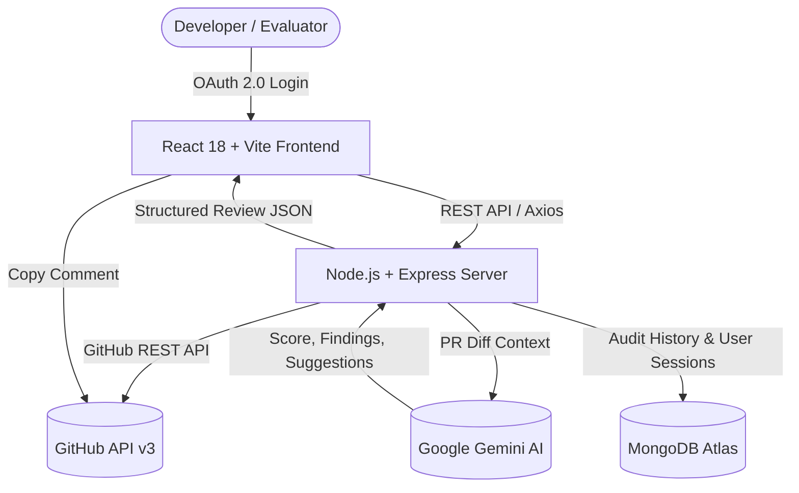

# ⚡ GitPulse — Automated GitHub PR Health & AI Code Review Engine

> **Next-Generation GitHub Pull Request Intelligence Platform**  
> An automated code health inspector and AI code reviewer built on the MERN stack with Google Gemini, GitHub REST API, and MongoDB Atlas.

---

## 📌 Problem Statement
Code reviews are critical for software quality, yet they are often time-consuming, bottleneck engineering velocity, and prone to human oversight. Junior developers frequently push pull requests containing edge-case regex bugs, unsanitized inputs, missing error handling, and inadequate testing. Senior reviewers spend disproportionate hours flagging repetitive code style, security, and complexity issues instead of focusing on high-level architecture.

---

## 🎯 Target Users
* **Software Engineers & Developers:** Receive instant, actionable feedback and suggested code patches before requesting senior human review.
* **Tech Leads & Maintainers:** Rapidly assess PR risk levels (Low, Medium, High) and overall health scores (0–100) to prioritize high-risk changes.
* **Engineering Teams & Open Source Projects:** Maintain consistent quality standards, enforce input sanitization, and streamline code reviews.

---

## 💡 Solution: GitPulse
**GitPulse** connects directly to GitHub via OAuth 2.0 and inspects real-time pull request diffs using **Google Gemini AI**. It calculates a comprehensive 0–100 Health Score, performs multi-vector quality analysis across 4 pillars (Complexity, Testing, Security, and Documentation), provides line-by-line recommendations with copyable code fixes, and exports formatted Markdown audit summaries ready to paste directly into GitHub PR comments.

---

## ✨ Key Features & Workflows

### 1. 🔐 GitHub OAuth 2.0 Authentication
* One-click GitHub authorization granting read-only access to repositories and pull requests.
* Secure JWT session management with HTTP-only cookies and MongoDB persistence.

### 2. 📂 Real-Time Repository & PR Explorer
* Search and browse all public and private repositories under your GitHub account.
* Filter pull requests by status: **All**, **Open**, or **Closed / Merged**.
* Direct navigation links to active repositories and branches on GitHub.

### 3. 🔍 Interactive Git Diff & Code Inspector
* Visualizes file modifications, additions (`+`), and deletions (`-`).
* Collapsible per-file diff views highlighting line numbers and exact code changes.

### 4. 🧠 Google Gemini AI Code Review & Dynamic Health Score
* Evaluates pull request diffs using Google Gemini (`gemini-3.5-flash` / `gemini-3.1-flash-lite`).
* **Animated Circular Gauge (0–100 Health Score)** with risk classification:
  * 🟢 **Low Risk** (Ready to merge)
  * 🟡 **Medium Risk** (Needs revisions)
  * 🔴 **High Risk** (Blocked / critical bugs detected)
* **4-Pillar Quality Breakdown**:
  * 📐 **Complexity** (0–100): Cyclomatic complexity, nesting, and algorithmic efficiency.
  * 🧪 **Testing** (0–100): Test coverage presence and unit test files.
  * 🛡️ **Security** (0–100): SQL/NoSQL injection risks, input sanitization, and secrets exposure.
  * 📝 **Documentation** (0–100): JSDoc / docstrings, comments, and README updates.

### 5. 🛠️ Actionable Recommendations & Code Fixes
* Filter findings by category: **Security**, **Performance**, **Bug**, **Style**, or **Improvement**.
* Copyable code snippets showing exact before/after fixes.
* **1-Click Markdown Comment Exporter:** Formats the entire audit into GitHub-flavored Markdown for pasting into PR threads.

### 6. 🕒 Persistent Audit History
* All review reports are permanently stored in **MongoDB Atlas**.
* Dedicated **Audit History Modal** to view, inspect, and reload past audit reports at any time.

---

## 🏗️ System Architecture



---

## 🛠️ Technology Stack

| Layer | Technologies |
|---|---|
| **Frontend** | React 18, Vite, Lucide Icons, Vanilla CSS (Glassmorphic dark design system) |
| **Backend** | Node.js, Express.js, Axios, Cookie-Parser, CORS |
| **Database** | MongoDB Atlas, Mongoose ODM |
| **AI Engine** | Google Gemini Generative AI (`gemini-3.5-flash` / `gemini-3.1-flash-lite`) |
| **Authentication** | GitHub OAuth 2.0, JSON Web Tokens (JWT) |

---

## 🚀 Local Development Setup

### Prerequisites
* **Node.js** (v18.0.0 or higher)
* **npm** (v9.0.0 or higher)
* **MongoDB Atlas** cluster URI
* **Google Gemini API Key** (from [Google AI Studio](https://aistudio.google.com/))
* **GitHub OAuth App** (Client ID & Client Secret from [GitHub Developer Settings](https://github.com/settings/developers))

---

### Step 1: Clone Repository
```bash
git clone https://github.com/sai-srujan29/Git-Pulse---Mern-End-term-project.git
cd Git-Pulse---Mern-End-term-project
```

---

### Step 2: Configure Environment Variables
Inside the `server/` directory, create a `.env` file based on `.env.example`:

```env
PORT=5000
NODE_ENV=development
CLIENT_URL=http://localhost:5173

MONGODB_URI=mongodb+srv://<username>:<password>@cluster.mongodb.net/gitpulse?retryWrites=true&w=majority

JWT_SECRET=your_jwt_secret_key_here
JWT_EXPIRES_IN=7d

GITHUB_CLIENT_ID=your_github_oauth_client_id
GITHUB_CLIENT_SECRET=your_github_oauth_client_secret
GITHUB_CALLBACK_URL=http://localhost:5000/api/auth/github/callback

GEMINI_API_KEY=your_google_gemini_api_key
```

Inside the `client/` directory, create a `.env` file:
```env
VITE_API_URL=http://localhost:5000/api
```

---

### Step 3: Install Dependencies
```bash
# Install backend dependencies
cd server
npm install

# Install frontend dependencies
cd ../client
npm install
```

---

### Step 4: Run the Application
In two separate terminals:

```bash
# Terminal 1: Run Backend Server (port 5000)
cd server
npm run dev

# Terminal 2: Run Frontend Development Server (port 5173)
cd client
npm run dev
```

Open your browser and navigate to **`http://localhost:5173`**!

---

## ⚡ Build and Start Commands

For evaluators and deployment environments:

| Scope | Build Command | Production Start Command | Dev Server Command |
|---|---|---|---|
| **Root (Unified)** | `npm run build` | `npm start` | `npm run server` / `npm run client` |
| **Backend (`/server`)** | *(Node runtime)* | `npm start` | `npm run dev` |
| **Frontend (`/client`)** | `npm run build` | `npm run preview` | `npm run dev` |

### Quick Commands Reference:
* **Root Installation:** `npm run install:all`
* **Build Frontend:** `npm run build` (or `cd client && npm run build`)
* **Start Server:** `npm start` (or `cd server && npm start`)
* **Start Dev Frontend:** `cd client && npm run dev` (runs on `http://localhost:5173`)
* **Start Dev Backend:** `cd server && npm run dev` (runs on `http://localhost:5000`)

---

## 🔒 Security Best Practices
* **No Plaintext Credentials:** Secrets and API keys are strictly maintained in local `.env` files and `.gitignore`.
* **Safe Cookie Policy:** JWT session cookies use `httpOnly: true` and `sameSite: 'lax'` to prevent XSS token theft.
* **Scoped OAuth:** Only requests minimal required permissions (`read:user`, `user:email`, `repo`).
* **Input Sanitization:** Validates request parameters and bounds query limits to prevent injection.

---

## 📜 End-Term Project Verification Checklist
- [x] Full source code committed to GitHub with clean development history
- [x] Working full-stack MERN software application with complete application logic
- [x] Real-time GitHub OAuth 2.0 authentication and user session persistence
- [x] Live GitHub REST API integration for repository, PR, and diff inspection
- [x] Google Gemini AI integration with dynamic health scoring & multi-model fallback
- [x] MongoDB Atlas persistent audit history
- [x] Comprehensive README with problem statement, architecture, workflows, and setup guide
- [x] Zero exposed secrets in repository history

---

Demo video drive link -- https://drive.google.com/file/d/1rG3jlihGxcgYiSUSKAfnD6f2POkjK5LR/view?usp=sharing

## 👨‍💻 Author
* **Sai Srujan** — https://drive.google.com/file/d/1rG3jlihGxcgYiSUSKAfnD6f2POkjK5LR/view?usp=sharing
* Repository: [Git-Pulse---Mern-End-term-project](https://github.com/sai-srujan29/Git-Pulse---Mern-End-term-project)
